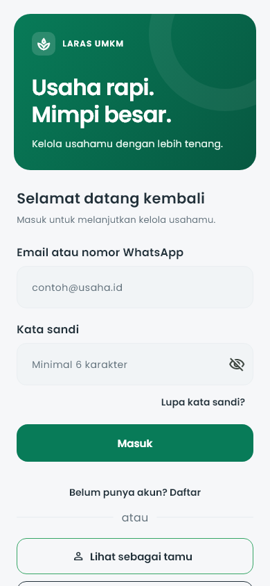
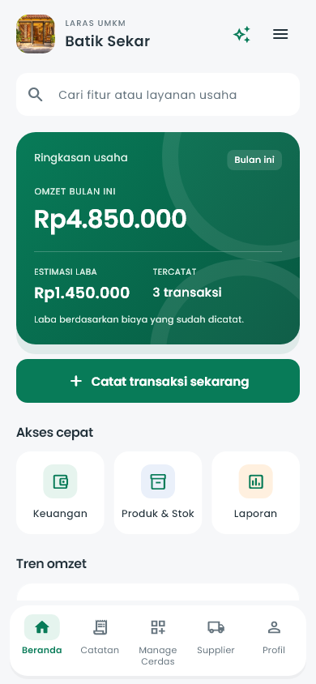
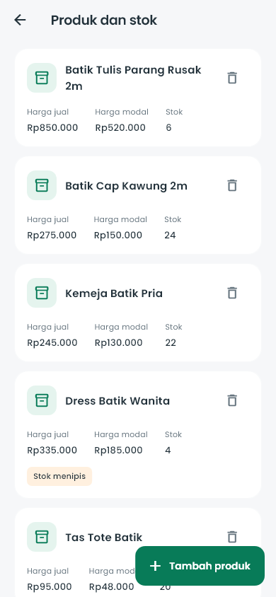
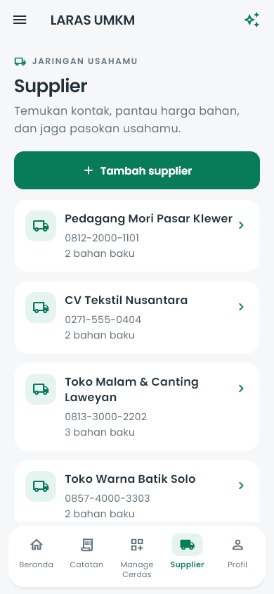
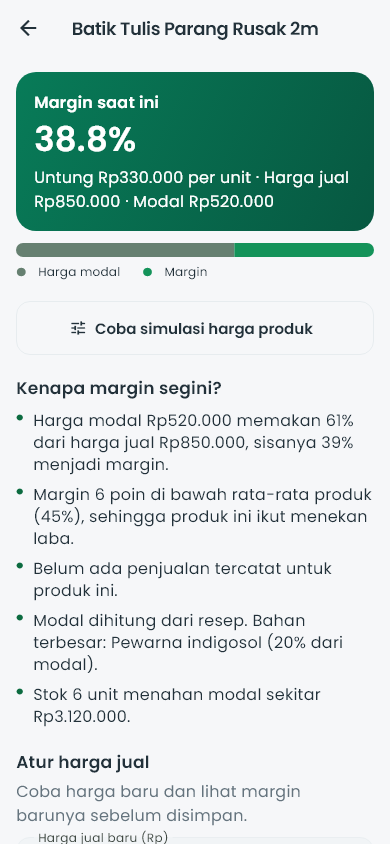
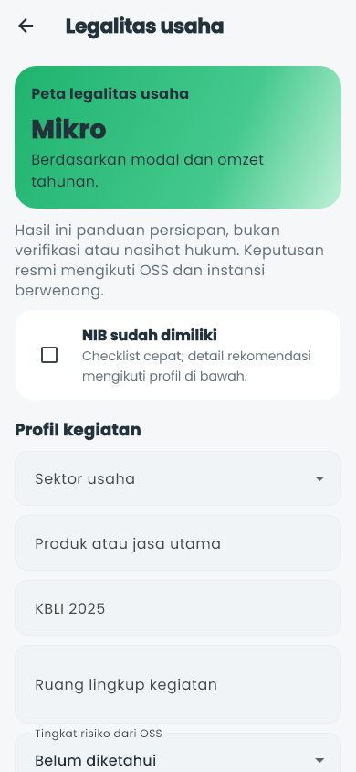
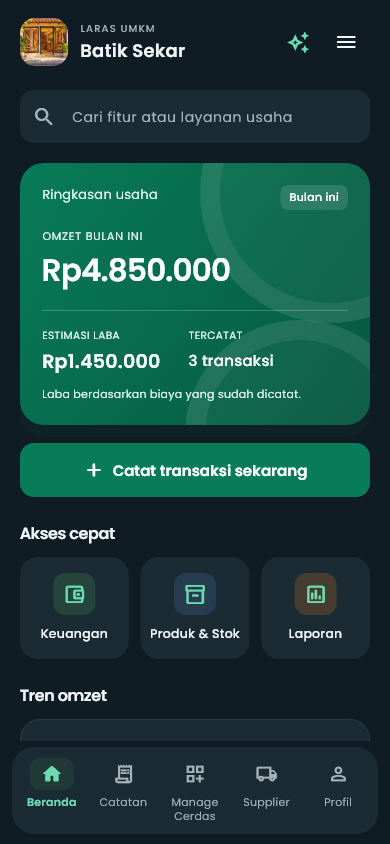
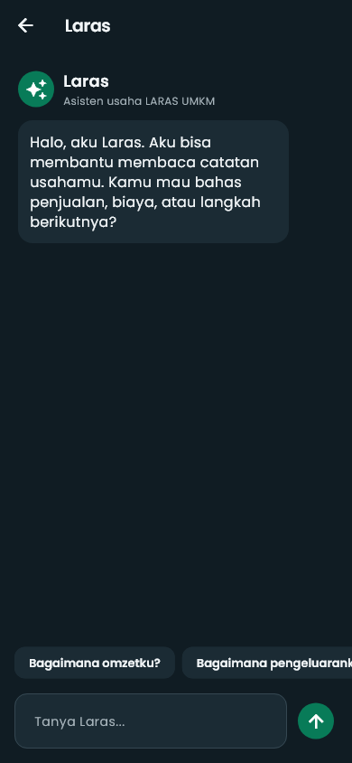

# LARAS UMKM

**Kelola transaksi, laporan, dan arah usaha.**

LARAS UMKM adalah aplikasi Flutter untuk membantu pelaku UMKM mencatat keuangan, memantau produk dan stok, mengelola supplier, menghitung harga dan margin, serta memahami kebutuhan legalitas usaha. Aplikasi berjalan di Android dan web, mendukung mode terang/gelap, dan menyimpan data secara lokal di perangkat atau browser.

> Catatan: aplikasi ini dikembangkan untuk **FOSTIFEST 2026 — Software Development Competition**. Status lisensi belum ditentukan.

## Masalah yang diselesaikan

- Catatan penjualan dan biaya sering tersebar di buku, chat, dan ingatan, sehingga omzet serta laba sulit dilihat.
- Harga bahan dari supplier berubah, tetapi dampaknya terhadap modal dan margin produk tidak terukur.
- Pelaku usaha sering menjual tanpa tahu apakah harga jual sudah menghasilkan untung.
- Dokumen legalitas usaha (NIB, KBLI, risiko OSS, sertifikat) tidak terdokumentasi dalam satu tempat.
- Data usaha perlu tetap bisa dipakai tanpa koneksi dan tanpa membuat akun di server.

## Fitur utama

- **Ringkasan usaha**: omzet, pengeluaran, estimasi laba, tren, dan produk terlaris.
- **Catat transaksi**: input manual, tempel teks chat, atau OCR foto catatan; pemasukan dan pengeluaran dengan validasi nominal.
- **Produk dan stok**: katalog, SKU, kategori, stok minimum, dan penyesuaian stok.
- **Supplier**: kontak, daftar bahan, harga, riwayat harga, penanda harga termurah, dan pencatatan pembelian ke keuangan.
- **Harga dan margin**: margin per produk, penyebab perubahan margin, serta pengaturan harga jual.
- **Simulasi Harga**: tersedia dari **Manage Cerdas**. Menghitung untung/rugi/impas, margin, dan proyeksi total berdasarkan biaya bahan, tenaga kerja, serta biaya lain. Skenario dapat disimpan maksimal 10 per perangkat.
- **Pelanggan**: kontak dan catatan pelanggan tanpa tagihan atau piutang.
- **Laporan**: laba-rugi, estimasi PPh final 0,5% dari omzet, dan ekspor/bagikan PDF.
- **Legalitas**: panduan berbasis profil usaha, skala, KBLI, risiko OSS, rekomendasi dokumen, detail dokumen, dan checklist lokal.
- **Profil usaha dan asisten Laras**: identitas toko, preferensi tampilan, dan panduan penggunaan aplikasi.
- **Tampilan adaptif**: mode terang/gelap dan tata letak untuk layar ponsel 360–414 px.

## Tangkapan layar

Semua gambar berasal dari golden test di `fostifest_companion/test/proposal/`.

| Tampilan | Tampilan |
|---|---|
| <br>Login | <br>Dashboard |
| <br>Produk dan stok | <br>Supplier |
| <br>Harga dan margin | <br>Legalitas |
| <br>Mode gelap | <br>Asisten Laras |

## Alur penggunaan singkat

1. Buka aplikasi, lalu masuk dengan akun demo atau daftar akun lokal.
2. Lihat ringkasan di **Beranda** dan catat transaksi pertama melalui **Catat Cerdas**.
3. Lengkapi **Produk & Stok** serta **Supplier** agar modal dan margin dihitung dari data nyata.
4. Gunakan **Harga & Margin** untuk mengevaluasi harga jual, lalu **Simulasi Harga** untuk mencoba skenario.
5. Buka **Legalitas** untuk melihat rekomendasi dokumen berdasarkan profil dan skala usaha.
6. Pantau **Laporan**, lalu ekspor PDF bila diperlukan.

## Teknologi

| Bagian | Teknologi |
|---|---|
| Framework | Flutter (Material 3) |
| Bahasa | Dart, SDK `>=3.5.0 <4.0.0` |
| Penyimpanan | `shared_preferences` (JSON lokal) |
| OCR | `google_mlkit_text_recognition` dan `image_picker` |
| Dokumen | `pdf` dan `printing` |
| Jaringan | `http` (backend opsional; default build berjalan lokal) |
| Berkas | `path_provider` |
| Font | Poppins dan Plus Jakarta Sans (lisensi OFL disertakan) |

Backend tidak disertakan dalam repositori ini. `lib/laras_api.dart` menyediakan kait opsional yang hanya aktif bila build dikonfigurasi dengan `LARAS_BACKEND=true` dan `LARAS_API_URL`; build default memakai penyimpanan lokal.

## Struktur folder

```text
fostifest_companion/
├── lib/          # Kode aplikasi, tema, komponen, dan fitur
├── assets/       # Gambar dan font
├── test/         # Pengujian dan screenshot proposal
├── web/          # Konfigurasi Flutter Web
└── android/      # Konfigurasi Android
```

Dokumentasi tambahan berada di root repositori: `CONTRIBUTING.md`, `DESIGN.md`, `SECURITY.md`, dan `CHANGELOG.md`. Konteks produk yang lebih panjang tersedia di `fostifest_companion/KONTEKS-LARAS.md`.

## Cara menjalankan aplikasi

Prasyarat: Flutter stable dengan Dart SDK sesuai `pubspec.yaml`. Untuk Android, siapkan Android SDK; untuk web, gunakan browser berbasis Chromium.

```powershell
cd fostifest_companion
flutter pub get
flutter run
```

Untuk web:

```powershell
cd fostifest_companion
flutter run -d chrome
```

Preview web lokal dapat dijalankan dengan `Buka Preview LARAS.cmd` di root repositori. Penjelasan lengkap ada di `CARA PREVIEW LARAS.md`.

## Cara menjalankan tes

```powershell
cd fostifest_companion
flutter analyze lib test
flutter test
```

Tes golden screenshot:

```powershell
flutter test test/proposal_capture_test.dart
```

Perbarui golden hanya jika perubahan tampilan memang disengaja, lalu periksa hasilnya:

```powershell
flutter test test/proposal_capture_test.dart --update-goldens
```

## Build web dan Android

Web:

```powershell
cd fostifest_companion
flutter build web --release -O1 --no-wasm-dry-run
```

Android ARM64:

```powershell
cd fostifest_companion
flutter build apk --release --target-platform android-arm64 --obfuscate --split-debug-info=build/symbols/arm64
```

Hasil build berada di `build/` dan tidak disimpan di Git. APK release juga tidak disertakan di repositori; hasil build perlu dibagikan melalui rilis atau kanal terpisah.

## Penyimpanan dan privasi data

- Data aplikasi disimpan di perangkat melalui `SharedPreferences`; versi web memakai penyimpanan browser.
- Tidak ada sinkronisasi antarperangkat dan tidak ada server aplikasi pada build default.
- Data dapat hilang jika aplikasi dihapus, data aplikasi dibersihkan, atau penyimpanan browser dihapus.
- Simulasi harga disimpan dengan kunci `laras_price_simulations_v1` dan dibatasi 10 skenario.
- Checklist serta profil legalitas disimpan dengan kunci `laras_legal_checklist_v2` dan `laras_legal_profile_v1`; data checklist lama dimigrasikan saat halaman dibuka.
- Akun aplikasi bersifat lokal, bukan autentikasi server. Jangan gunakan kata sandi yang sama dengan akun penting lain.
- Fitur kamera, OCR, dan cetak dapat berperilaku berbeda di web. Periksa kembali hasilnya sebelum dipakai untuk keputusan usaha.

## Status fitur dan batasan

**Sudah tersedia**

- Pencatatan transaksi, produk/stok, pelanggan, supplier, laporan, legalitas, dan profil usaha.
- Simulasi harga dengan penyimpanan skenario lokal.
- Mode terang/gelap dan pengujian tata letak 360–414 px.
- Ekspor PDF untuk laporan.

**Batasan**

- Belum ada backend produksi, sinkronisasi lintas perangkat, atau pencadangan cloud.
- Tidak memproses pembayaran digital, QRIS, atau payment gateway.
- Estimasi pajak bersifat informatif, bukan pengganti perhitungan pajak resmi.
- Signing Android release masih memakai konfigurasi debug; belum ada kunci produksi.
- Repositori belum memiliki `LICENSE`; status lisensi menunggu keputusan tim.
- Panduan legalitas bersifat edukatif dan perlu diverifikasi melalui OSS atau instansi resmi.

## Kontributor

Berdasarkan metadata commit pada repositori:

- `ioneh99-art`
- `rizkidsaputra`

Daftar nama lengkap, peran, dan afiliasi resmi belum tercatat di repositori. Ketua tim dapat melengkapinya sebelum penjurian.

## Lisensi dan catatan kompetisi

Repositori ini belum menyertakan berkas lisensi. Aplikasi dikembangkan untuk FOSTIFEST 2026 dan menggunakan font Poppins serta Plus Jakarta Sans yang lisensinya tersedia di folder `fostifest_companion/assets/fonts/`. Aplikasi disebut sebagai hasil rebranding dari aplikasi referensi Logicodix/BUMIRA; pastikan atribusi dan izin komponen pihak ketiga sesuai ketentuan kompetisi.

## Dokumentasi lain

- `CONTRIBUTING.md` — alur kontribusi dan standar pengujian.
- `DESIGN.md` — token desain, komponen, dan pedoman tampilan.
- `SECURITY.md` — pelaporan masalah keamanan.
- `CHANGELOG.md` — ringkasan perubahan.
- `fostifest_companion/README.md` — panduan singkat proyek Flutter.
- `fostifest_companion/KONTEKS-LARAS.md` — konteks produk dan teknis (sebagian bersifat historis).
- `fostifest_companion/LARAS_IMPLEMENTATION_REPORT.md` — laporan implementasi.
