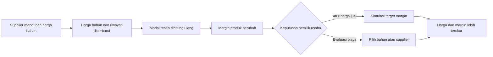
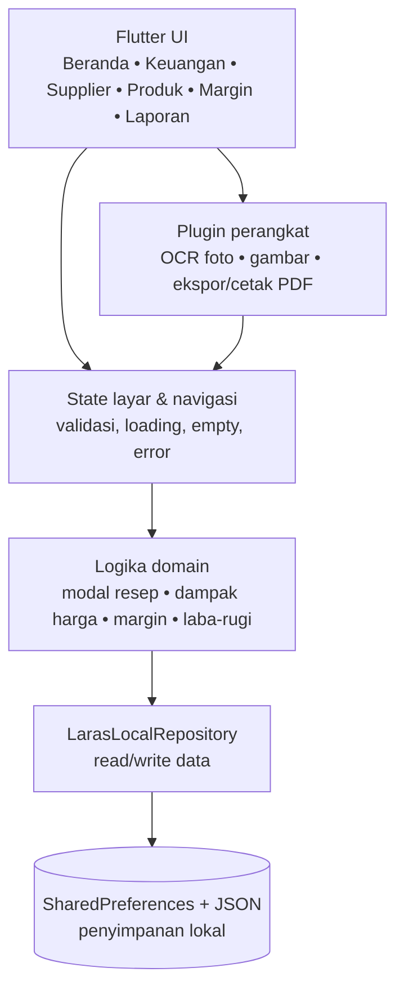
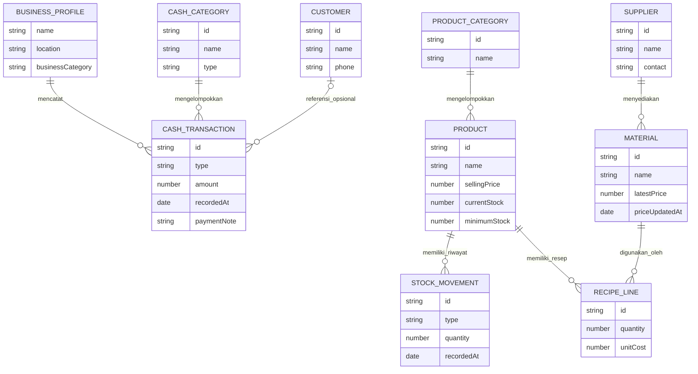

# LARAS UMKM

> **Laporan Arus Kas dan Analisis Usaha**
>
> *Kenali usahamu, tentukan arah.*

LARAS UMKM adalah aplikasi Android offline-first untuk usaha mikro produksi. LARAS menghubungkan harga bahan dari supplier, modal produk, margin, arus kas, stok, dan laporan usaha sehingga pemilik dapat menetapkan harga berdasarkan data yang mereka catat sendiri.

LARAS bukan aplikasi pembayaran. MVP ini tidak memiliki QRIS, payment link, POS/kasir, piutang, kredit, maupun integrasi rekening bank.

## Masalah yang diselesaikan

| Tantangan pemilik usaha | Dampak | Jawaban LARAS |
| --- | --- | --- |
| Catatan pemasukan dan pengeluaran tersebar | Laba serta arus kas tidak terlihat | Pencatatan transaksi, kategori kas, dan laporan laba-rugi |
| Harga bahan naik tanpa dihitung ulang | Margin menipis tanpa disadari | Supplier, riwayat harga bahan, resep, dan modal otomatis |
| Harga jual hanya berdasarkan perkiraan | Produk berisiko dijual terlalu murah | Analisis margin dan simulasi harga jual |
| Stok serta administrasi belum tertata | Belanja bahan dan legalitas terlambat | Stok minimum, checklist legalitas, dan laporan PDF |

## MVP yang sudah tersedia

- **Beranda usaha**: ringkasan pemasukan, pengeluaran, estimasi laba, tren, dan tindakan cepat.
- **Keuangan**: catatan pemasukan/pengeluaran, kategori kas, riwayat, pencarian, dan laporan laba-rugi.
- **Supplier & bahan**: kontak pemasok, riwayat harga bahan, dan pencatatan pembelian bahan.
- **Produk, resep & stok**: katalog produk, stok minimum, komposisi bahan, upah, serta overhead.
- **Harga & Margin**: modal otomatis, dampak perubahan harga bahan, target margin, dan simulasi harga jual.
- **Pelanggan**: data kontak dan catatan hubungan pelanggan tanpa piutang.
- **Laporan & legalitas**: rangkuman usaha, ekspor PDF, dan checklist NIB, merek/P-IRT, serta halal.
- **Bantuan & privasi**: panduan penggunaan, profil usaha, mode gelap, dan penjelasan data lokal.

## Alur nilai utama



## Arsitektur aplikasi

LARAS memakai arsitektur monolit client-side. Seluruh fungsi inti diproses di perangkat, tanpa backend atau panggilan API eksternal.



## ERD konseptual MVP



## Batasan MVP

- Data disimpan lokal melalui `SharedPreferences`; belum ada cloud sync, multi-pengguna, atau pemulihan otomatis.
- Metode pembayaran di pencatatan pemasukan hanya catatan manual, bukan verifikasi atau proses pembayaran.
- Margin adalah margin kotor; laporan dan estimasi pajak merupakan bantuan pengelolaan, bukan perhitungan pajak resmi.

## Struktur repository

- [`fostifest_companion/`](fostifest_companion): kode aplikasi Flutter.
- [`fostifest_companion/README.md`](fostifest_companion/README.md): dokumentasi teknis aplikasi dan instruksi build.
- [`GUIDEBOOK-SOFTWARE-DEVELOPMENT-FOSTIFEST-2026.md`](GUIDEBOOK-SOFTWARE-DEVELOPMENT-FOSTIFEST-2026.md): konteks kompetisi.

## Menjalankan aplikasi

```powershell
cd fostifest_companion
flutter pub get
flutter run
```
