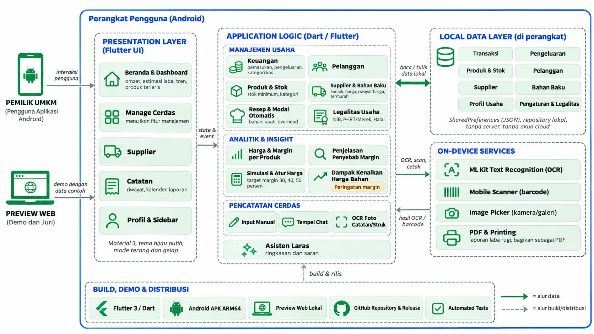
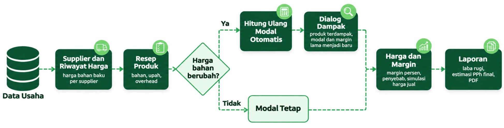

# LARAS UMKM

**Laporan Arus Kas dan Analisis Usaha**  
*Kenali usahamu, tentukan arah.*

LARAS UMKM adalah aplikasi pembukuan dan analisis margin berbasis harga bahan baku untuk usaha mikro produksi. Aplikasi dibangun menggunakan **Flutter/Dart** untuk Android, dengan versi web sebagai pratinjau demonstrasi. Fungsi inti dirancang **offline-first**, tanpa backend, dan menyimpan data usaha secara lokal di perangkat.

## Arsitektur Sistem




Arsitektur aplikasi menggunakan pendekatan **client-side**: antarmuka Flutter meneruskan aksi pengguna ke logika aplikasi, lalu data dibaca dan ditulis melalui penyimpanan lokal (`SharedPreferences` berbasis JSON). Komponen pada perangkat digunakan untuk OCR foto catatan serta pembuatan dan pembagian laporan PDF. Aplikasi tidak memerlukan server atau API eksternal untuk fungsi intinya.

## Alur Rantai Biaya dan Perubahan Harga Bahan




Harga bahan dari supplier menjadi masukan untuk resep dan modal produk. Ketika harga bahan berubah, aplikasi menghitung ulang modal produk berbasis resep dan menampilkan **dampak pada modal serta margin**. Pengguna dapat meninjau harga dan margin lalu mencoba simulasi harga jual. Jika harga bahan tidak berubah, modal tetap. **Margin produk adalah margin kotor**, sedangkan laporan kas bulanan dihitung dari catatan pemasukan dan pengeluaran; penjualan belum ditautkan langsung ke produk.

## Fitur MVP

- Dashboard omzet, estimasi laba, tren, dan produk terlaris.
- Pembukuan transaksi melalui input manual, chat, atau OCR foto catatan.
- Pelanggan, produk, stok minimum, kategori, dan laporan laba-rugi.
- Tidak memproses pembayaran digital, QRIS, atau payment gateway.
- Kalender transaksi dan laporan laba-rugi yang dapat dibagikan sebagai PDF.
- Daftar legalitas UMKM untuk mencatat status dokumen usaha.
- Profil usaha lokal serta asisten Laras.
- **Manage Cerdas**: layar ikon fitur manajemen usaha (Keuangan, Pelanggan, Produk & Stok, Supplier, Harga & Margin, Laporan, Catat Transaksi, Legalitas, Asisten Laras).
- **Harga & Margin**: margin tiap produk, penjelasan penyebab margin, dan pengaturan harga jual dengan target margin.
- **Simulasi harga produk**: buka Manage Cerdas → Harga & Margin → Simulasi harga produk (juga tersedia di pencarian dan sidebar). Harga jual Rp0–Rp10 juta dengan slider dan input rupiah tepat; jumlah produk 1–1 juta. Biaya per produk berasal dari bahan supplier atau input manual, tenaga kerja, dan biaya lainnya. Menampilkan untung/rugi/impas, margin terhadap harga jual, dan proyeksi total jika seluruh jumlah terjual.
- **Simpanan simulasi**: maksimal 10 skenario di perangkat/browser yang sama. Simpan, buka ulang, atau hapus melalui ikon bookmark. Rincian bahan/harga/supplier disalin saat disimpan; perubahan supplier selanjutnya tidak mengubah skenario lama. Percobaan tidak mengubah harga produk, persediaan, atau pembukuan.
- **Supplier**: daftar pemasok bahan baku, kontak, harga bahan, riwayat harga, penanda harga termurah, dan pencatatan pembelian bahan ke Keuangan.
- **Resep & modal otomatis**: modal produk dihitung dari harga bahan supplier, upah, dan overhead. Kenaikan harga bahan memperbarui modal produk dan menampilkan dampaknya ke margin.
- Sidebar fitur dan data demo usaha batik (Batik Sekar) yang terisi saat masuk dengan akun demo atau tamu.

## Menjalankan aplikasi

```powershell
flutter pub get
flutter run
```

## Build APK Android

```powershell
flutter build apk --release --target-platform android-arm64 --obfuscate --split-debug-info=build/symbols/arm64
```

APK ARM64 teroptimasi juga tersedia sebagai `FOSTIFEST-2026-arm64-release.apk`.

## Preview web lokal

Klik `Buka Preview LARAS.cmd` di folder induk (lihat `CARA PREVIEW LARAS.md`). Preview tersedia di `http://127.0.0.1:43827/`.

## Dokumentasi

- `KONTEKS-LARAS.md`: konteks produk dan teknis lengkap.
- `LARAS_IMPLEMENTATION_REPORT.md`: laporan implementasi.

## Penyimpanan simulasi

Proyek ini belum menggunakan server API atau database jarak jauh. Logika simulasi ada di `lib/price_simulation.dart`, terpisah dari antarmuka, memakai SharedPreferences seperti data usaha yang sudah ada. Kunci khusus `laras_price_simulations_v1` menyimpan JSON skenario lengkap. Penyimpanan menolak skenario ke-11, mengantre operasi simpan/hapus, memvalidasi isi, dan tidak menimpa data yang gagal dibaca. Data tidak tersinkron antarperangkat dan dapat hilang bila data situs/peramban dihapus.

Rumus: biaya produksi = pembulatan jumlah (kuantitas bahan × harga satuan) + tenaga kerja + biaya lainnya per produk; untung/rugi per produk = harga jual − biaya produksi; margin = untung/rugi ÷ harga jual × 100%; proyeksi total = untung/rugi per produk × jumlah terjual. Margin ditampilkan “—” jika harga jual Rp0. Semua biaya bahan dan biaya tambahan adalah biaya untuk satu produk. Perkiraan tidak memasukkan biaya di luar rincian yang diisi pengguna.
