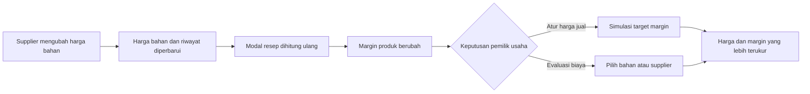
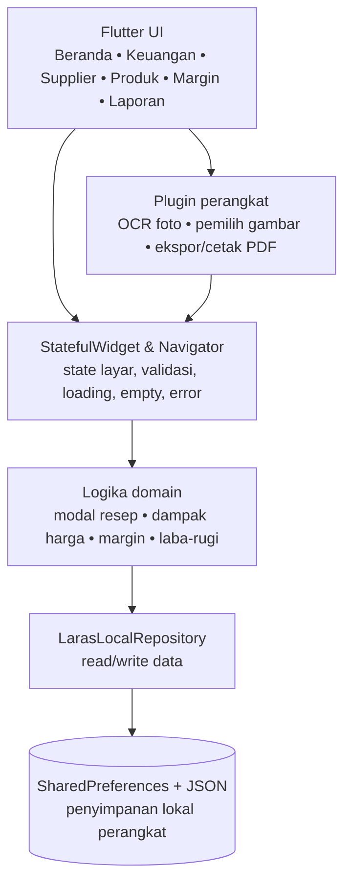
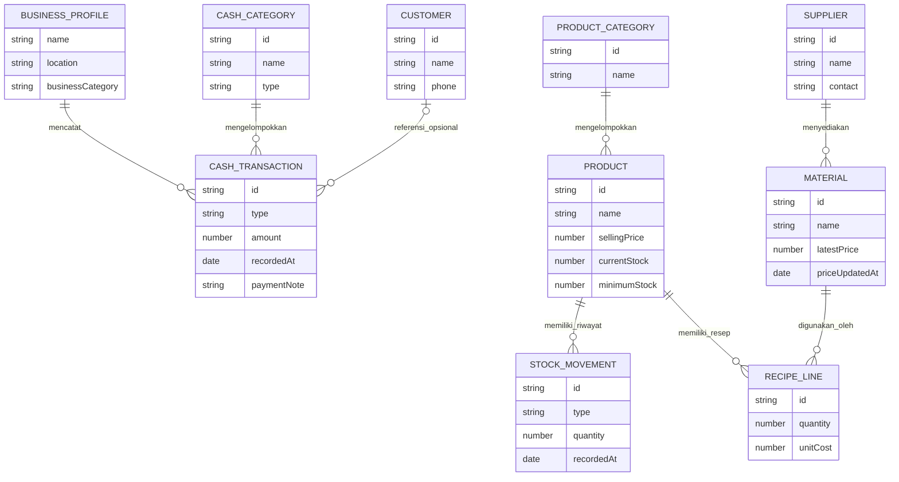

# LARAS UMKM

> **Laporan Arus Kas dan Analisis Usaha**
> *Kenali usahamu, tentukan arah.*

LARAS UMKM adalah aplikasi Android offline-first untuk usaha mikro produksi. Aplikasi ini menghubungkan harga bahan dari supplier, modal produk, margin, arus kas, stok, dan laporan usaha agar pemilik usaha dapat mengambil keputusan harga berdasarkan data yang mereka catat sendiri.

LARAS tidak dibuat untuk memproses pembayaran, QRIS, kasir/POS, piutang, maupun kredit. Fokus MVP-nya adalah pembukuan sederhana dan analisis biaya produksi yang mudah dipahami tanpa latar belakang akuntansi.

## Masalah yang diselesaikan

| Masalah usaha mikro produksi | Dampak | Jawaban LARAS |
| --- | --- | --- |
| Catatan pemasukan dan pengeluaran tersebar | Pemilik sulit melihat laba dan arus kas | Pencatatan transaksi, kategori kas, dan laporan laba-rugi |
| Harga bahan berubah tanpa dihitung ulang | Margin menipis tanpa disadari | Supplier, riwayat harga bahan, resep, dan modal otomatis |
| Harga jual ditetapkan berdasarkan perkiraan | Produk berisiko dijual terlalu murah | Analisis margin dan simulasi harga jual |
| Stok dan administrasi usaha belum tertata | Keputusan belanja dan legalitas terlambat | Produk & stok minimum, checklist legalitas, dan laporan PDF |

## Fitur MVP

- **Beranda usaha**: ringkasan pemasukan, pengeluaran, estimasi laba, tren, dan jalan pintas tindakan utama.
- **Keuangan**: pemasukan dan pengeluaran manual, kategori kas, pencarian, riwayat, serta laporan laba-rugi. Input dapat dibantu melalui teks chat atau OCR foto catatan.
- **Supplier & bahan**: kontak pemasok, harga bahan, riwayat perubahan harga, dan pencatatan pembelian bahan ke keuangan.
- **Produk, resep & stok**: katalog produk, stok minimum, bahan resep, biaya tenaga kerja, dan overhead.
- **Harga & Margin**: modal otomatis, margin tiap produk, dampak kenaikan harga bahan, simulasi target margin, dan penerapan harga jual.
- **Pelanggan**: data kontak dan catatan hubungan pelanggan tanpa fitur piutang.
- **Laporan & legalitas**: rangkuman usaha, ekspor PDF, dan checklist dokumen seperti NIB, merek/P-IRT, serta halal.
- **Bantuan & privasi**: panduan pemakaian, profil usaha, mode gelap, dan penjelasan penyimpanan data lokal.

## Alur nilai utama



## Arsitektur aplikasi

LARAS memakai arsitektur monolit client-side. Tidak ada backend, akun cloud, maupun panggilan API eksternal untuk fungsi inti. Seluruh perhitungan dan data MVP diproses di perangkat.



## ERD konseptual MVP

Diagram ini menggambarkan relasi data inti yang dipakai untuk alur biaya, margin, stok, dan pembukuan. Beberapa entitas disimpan sebagai koleksi JSON lokal agar MVP tetap ringan dan dapat berjalan tanpa server.



## Batasan MVP yang disengaja

- Data tersimpan di perangkat melalui `SharedPreferences`; belum ada sinkronisasi cloud, multi-pengguna, atau pemulihan otomatis.
- Metode pembayaran pada catatan pemasukan hanya metadata manual, bukan checkout atau verifikasi pembayaran.
- LARAS tidak memiliki QRIS, payment link, rekening bank, gateway, POS/kasir, piutang, maupun pembayaran digital.
- Margin adalah margin kotor per produk. Estimasi pajak dan laporan adalah bantuan pengelolaan usaha, bukan perhitungan pajak resmi.

## Teknologi

- Flutter dan Dart
- `SharedPreferences` untuk persistence lokal JSON
- ML Kit Text Recognition untuk OCR catatan
- `pdf` dan `printing` untuk laporan PDF
- `image_picker` dan `path_provider` untuk input serta penyimpanan perangkat

## Menjalankan aplikasi

```powershell
cd fostifest_companion
flutter pub get
flutter run
```

### Build APK Android ARM64

```powershell
flutter build apk --release --target-platform android-arm64 --obfuscate --split-debug-info=build/symbols/arm64
```

### Preview web lokal

Klik `Buka Preview LARAS.cmd` di folder induk, lalu buka [http://127.0.0.1:43828/](http://127.0.0.1:43828/).

## Dokumentasi proyek

- [`DESIGN.md`](DESIGN.md): sistem visual LARAS.
- [`KONTEKS-LARAS.md`](KONTEKS-LARAS.md): konteks produk dan teknis.
- [`LARAS_IMPLEMENTATION_REPORT.md`](LARAS_IMPLEMENTATION_REPORT.md): ringkasan implementasi dan batasan.

## Pembaruan terbaru

- **Manajemen Cashflow**: ringkasan uang masuk dan keluar, grafik, tipe arus kas, struktur biaya, pengaruh harga bahan baku, simulasi "bagaimana jika", dan saran.
- **Utang & Piutang**: catat pesanan yang belum dibayar dan belanja tempo, lengkap dengan jatuh tempo; pembayaran otomatis masuk ke catatan keuangan.
- **Titik Impas & Dana Cadangan**: omzet minimal agar tidak rugi dan berapa lama usaha bertahan tanpa penjualan.
- **Tempel Chat**: tempel pesan WhatsApp atau Instagram, LARAS membaca pesanan, lalu kamu verifikasi sebelum disimpan.
- **AI Insight** di Beranda, **Produk & Stok** yang lebih rapi (cari, filter, ubah stok cepat), dan **Legalitas** dengan 16 izin dan pengingat masa berlaku.
- **Panduan** dengan kamus istilah keuangan, laporan **PDF** terstruktur dengan insight, pemilih rentang tanggal di Laporan, serta pop-up dan tampilan yang diseragamkan.
